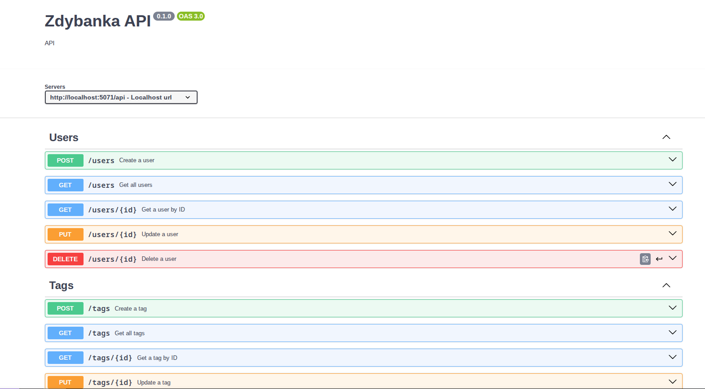

# Zdybanka

## API документація



[OpenAPI](docs/api/openapi.yaml)

## Перевірка Docker

Переконайтеся, що Docker запущений:

```bash
docker version
docker run hello-world
```

`docker version` показує версії клієнта й сервера. `hello-world` завантажує тестовий образ за потреби та виводить повідомлення про успішний запуск контейнера.

## Збірка та запуск контейнерів

У проєкті є `.dockerignore` у `client/` і `backend/`, а також відповідні `Dockerfile`. Збирайте образи з контекстів їхніх каталогів під тегами, які використовує Compose:

```bash
docker build -t zdybanka-web:1.0.0 ./client
docker build -t zdybanka-api:1.1.0 ./backend
```

Запустити фронтенд окремим контейнером:

```bash
docker run --rm -p 3000:80 zdybanka-web:1.0.0
```

Застосунок буде доступний на http://localhost:3000. API слухає порт `5000` у контейнері; для спільного запуску з БД використовуйте Docker Compose нижче.

## Docker Compose

`docker-compose.yaml` містить сервіси:

- `web` — Flutter Web за Nginx, порт хоста `3000` → порт контейнера `80`; проксіює `/api/` і `/hubs/` до API.
- `api` — ASP.NET API на порту `5000`, використовує `db` через `ConnectionStrings__ConnectionString`.
- `db` — PostgreSQL `15.3` на порту `5432`, з томом `postgres_data` та ініціалізацією з `db/init.sql`.

Перед запуском зберіть образи командами вище. Compose читає `DB_USER` і `DB_PASSWORD` із `.env` у корені репозиторію.

```bash
docker compose up -d
docker compose ps
```

Перевірити API через HTTP можна запитом до health endpoint через проксі фронтенду:

```bash
curl http://localhost:3000/api/Telemetry/health
```

Очікувана відповідь endpoint за кодом API: HTTP 200 з JSON `{"status":"ok"}`.

Зупинити сервіси:

```bash
docker compose down
```
